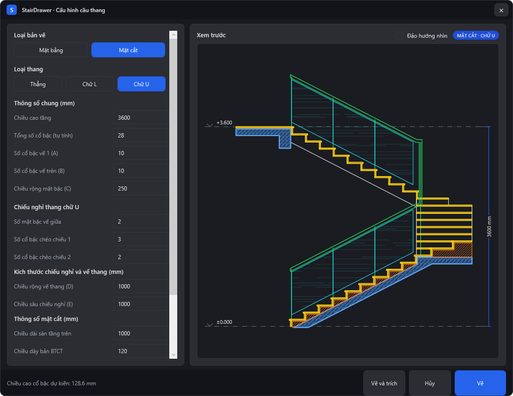
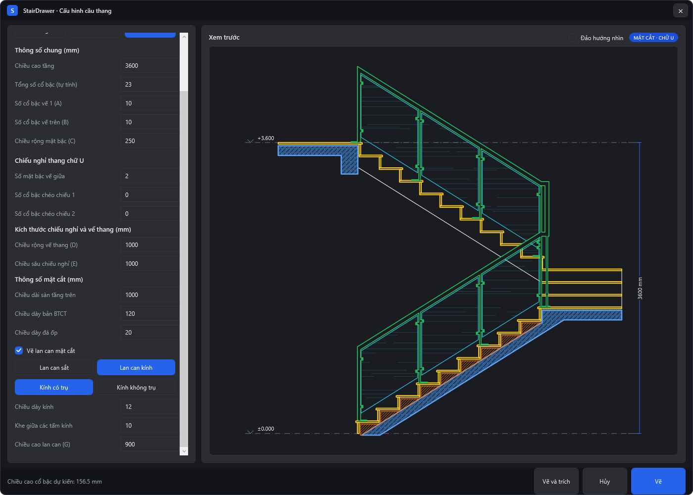
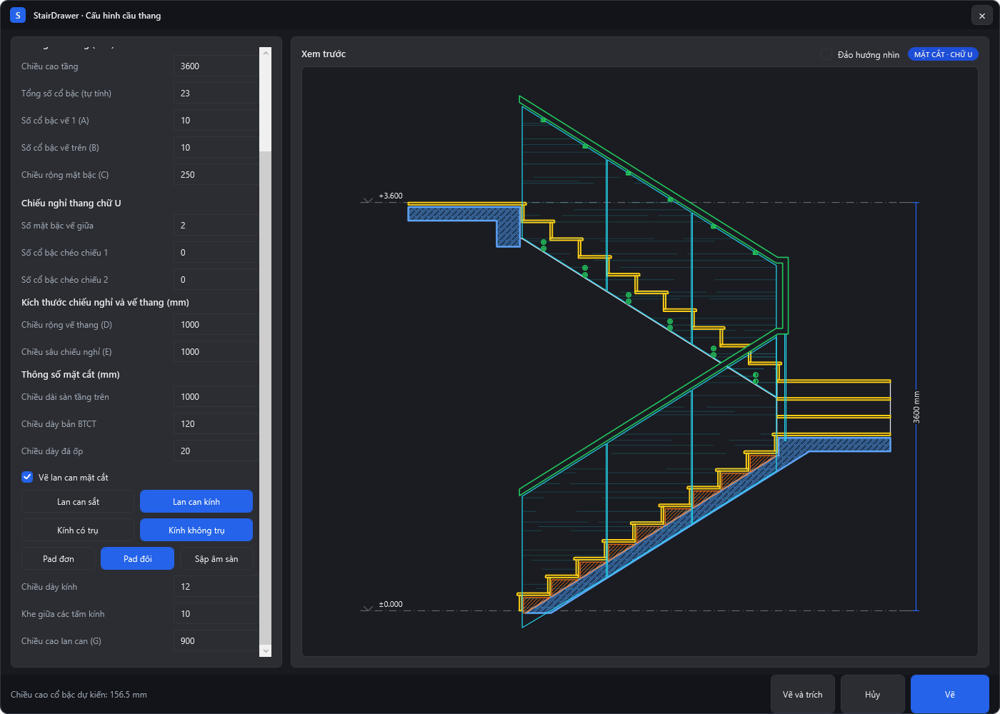
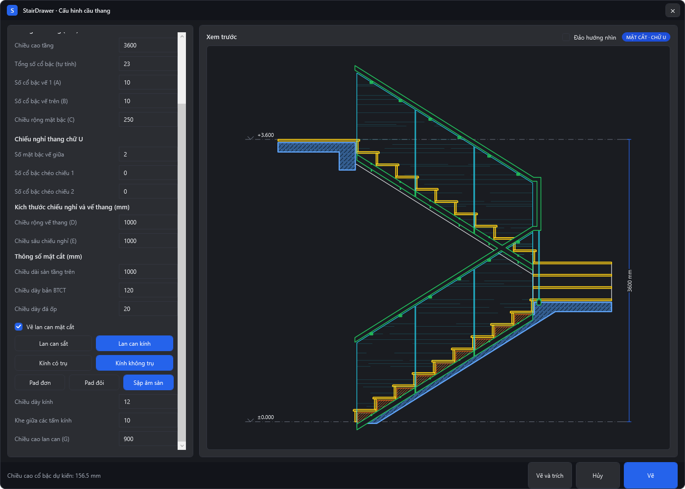
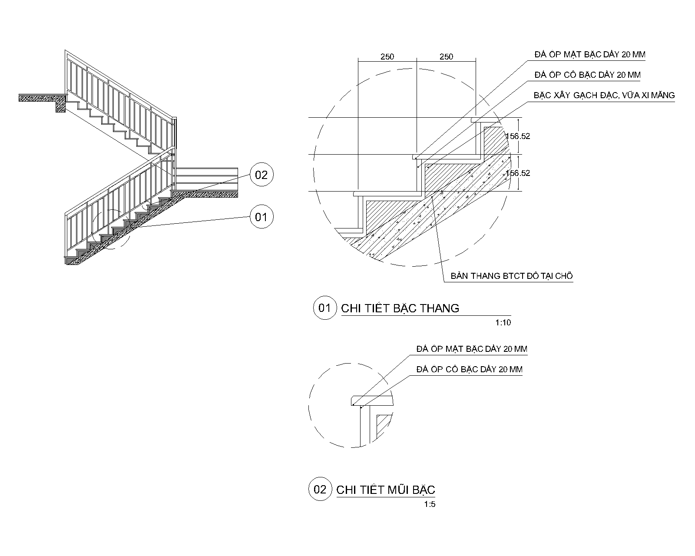

# StairDrawer

Plugin AutoCAD để vẽ mặt bằng, mặt cắt và trích chi tiết cầu thang thẳng, chữ L, chữ U. Giao diện WPF có preview, thông số cấu tạo, lan can và vết cắt A–A có thể điều chỉnh.



## Mở công cụ

Sau khi nạp plugin, mở **TH Tools → Cầu thang** trên ribbon hoặc nhập lệnh:

| Icon | Nút trên ribbon | Lệnh | Công dụng |
| --- | --- | --- | --- |
|  | **Vẽ thang** | `STAIRDRAW` | Mở giao diện vẽ mặt bằng hoặc mặt cắt. |
|  | **Trích chi tiết** | `STAIRDETAIL` | Tự trích cả bậc thang và mũi bậc từ mặt cắt đã có. |

Ribbon dùng chung tab **TH Tools** với TPL (`TH_TOOLS_TAB`). StairDrawer tạo panel riêng **Cầu thang**, giữ nguyên panel của TPL, tự bổ sung lại khi đổi workspace và tránh tạo trùng nút. Có thể dùng StairDrawer độc lập khi chưa cài TPL. Icon vector có kích thước 16/32 px và nằm sẵn trong DLL.

## Chức năng

### Mặt bằng

- Thang thẳng, chữ L, chữ U; thang thẳng có tùy chọn thêm chiếu nghỉ.
- Thang chữ U có thể thêm vế giữa hai chiếu nghỉ và chia từng chiếu thành các bậc chéo theo số lượng nhập.
- Số bậc lẻ đặt vào từng bậc, tính cả bậc vế giữa và bậc chéo.
- Tùy chọn vẽ lan can; tay vịn có hai mép và hai đầu, bề rộng 50 mm, cạnh gần cách mép bậc 50 mm.
- Lan can mặt bằng thể hiện bằng đường bao liên tục như lan can sắt; không chia tấm kính, không vẽ phụ kiện và không có lựa chọn mẫu lan can ở chế độ mặt bằng.
- Preview có dim kích thước và vết cắt A–A. Kéo vết cắt trong preview hoặc đảo hướng nhìn để cập nhật mặt cắt tương ứng.

### Mặt cắt

- Thể hiện phần bị cắt và phần nhìn thấy theo vết A–A; vế quay 90° của thang chữ L được chiếu đứng theo hướng nhìn.
- Thang chữ U giữ vế trên quay ngược, chồng hình như mặt cắt chữ U; thể hiện các bậc giữa, bậc chéo, cạnh bậc và chiều dày đá.
- Hai đường tim trục thể hiện cốt sàn dưới, sàn trên và chiều cao tầng.
- Đầu bản thang bắt đầu tại chân thang, không thêm đoạn sàn ngang phía dưới.
- Lan can sắt hoặc kính; tay vịn rộng 50 mm, trụ tại chiếu nghỉ/vế giữa rộng 20 mm.

### Liên kết lan can kính

Trong chế độ **Mặt cắt**, chọn **Lan can kính** rồi chọn cấu tạo:

| Cấu tạo | Liên kết được thể hiện |
| --- | --- |
| **Kính có trụ** | Trụ có chiều dày, bản mã chân trụ, kẹp giữ mép kính và đầu trụ tiếp giáp tay vịn. |
| **Kính không trụ – Pad đơn** | Pad tại các vị trí đỡ tấm kính; kính kéo xuống vùng liên kết với bản thang; kẹp và giá đỡ nối kính với tay vịn. |
| **Kính không trụ – Pad đôi** | Hai pad theo chiều cao tại mỗi vị trí đỡ, cùng liên kết kính–tay vịn. |
| **Kính không trụ – Sập âm sàn** | Profile chân kính, kính ngàm vào profile và giá đỡ tay vịn tại phần nhìn thấy. |

Có thể nhập **chiều dày kính 6–40 mm** và **khe giữa tấm 5–50 mm**; mặc định 12 và 10 mm. Các lựa chọn cấu tạo chỉ áp dụng cho mặt cắt; mặt bằng luôn dùng đường bao lan can liên tục. Tay vịn kính và sắt nối qua chiếu nghỉ, vế giữa chữ U và chỗ quay chữ L; xử lý đường bao kim loại để giảm nét chồng tại mối nối.

Không vẽ nét thân vít, bu lông hoặc đầu neo chìm trong mặt bậc. Với kính không trụ, pad, profile và giá đỡ chỉ thể hiện ở phần nhìn thấy; không thể hiện các liên kết này ở vế/chiếu bị cắt qua. Quy tắc này cập nhật theo vị trí A–A và hướng nhìn; pad nhìn thấy vẫn được giữ khi lật mặt cắt.

Các chi tiết liên kết là hình học minh họa cấu tạo; kích thước pad, bản mã, profile và neo cần chốt theo hệ phụ kiện và thiết kế kết cấu thực tế. Tham khảo kiểu liên kết: [pad điểm của SADEV](https://www.sadev.com/products/glass-balustrades/glass-railing-post/slab-nose-points/000110/), [giá tay vịn kẹp kính](https://www.sadev.com/products/glass-balustrades/handrails/on-support/glass-clamped-handrail/).







Các kích thước mặc định chính: **chiều cao tầng 3600 mm**, **chiều rộng mặt bậc 250 mm**. Thông số được nhập theo đơn vị bản vẽ; các giá trị mặc định và preview được thiết kế cho bản vẽ milimét. Hình học nằm trên WCS XY tại cao độ Z của điểm chèn.

### Cấu tạo và hatch

| Phần | Thể hiện |
| --- | --- |
| Bản thang BTCT | Hatch tùy chỉnh `M_BTCT`, scale **10**, được đóng kèm bundle. |
| Bậc xây gạch | Hatch `ANSI31`; scale 4 trong bản vẽ metric. |
| Kính lan can | Hatch `AR-RROOF`, scale **10**, màu kính nhạt, trong suốt 75%; liên kết với đường bao từng tấm. |
| Đá mặt bậc | Có chiều dày, mũi nhô 20 mm và cạnh vát; sàn tầng trên có mũi nhô tương ứng. |
| Vữa mặt bậc/sàn | Khoảng trống dày **20 mm** giữa kết cấu/gạch và đá hoàn thiện. |
| Vữa cổ bậc | Khoảng trống dày **15 mm** giữa gạch và lớp ốp cổ bậc. |

Mẫu kính có tên chuẩn **AR-RROOF** trong AutoCAD, dùng dấu gạch ngang. Preview thể hiện cùng mẫu hatch. Các lớp vữa chỉ thể hiện tại phần bị cắt qua; giữ nguyên vị trí hoàn thiện, chiều rộng mặt bậc và chiều cao bậc. Khi in độ trong suốt của hatch, bật **Plot transparency** trong thiết lập in.

## Cách vẽ thang

1. Chạy `STAIRDRAW` hoặc bấm **Vẽ thang** trên ribbon.
2. Chọn **Mặt bằng/Mặt cắt** và loại thang.
3. Nhập kích thước, số bậc, chiếu nghỉ/bậc chéo và tùy chọn lan can. Xem kết quả trên preview.
4. Điều chỉnh A–A khi cần chọn vị trí cắt và hướng nhìn.
5. Bấm **Vẽ**, chọn điểm chèn và điểm xác định hướng trục X trong AutoCAD.

Trong chế độ mặt cắt, bấm **Vẽ và trích** để tạo mặt cắt dạng block và tự trích cả hai chi tiết sau khi đặt thang. Esc hủy bước chọn đang thực hiện.

## Trích chi tiết thang

### Từ mặt cắt đã có

1. Chạy `STAIRDETAIL` hoặc bấm **Trích chi tiết**.
2. Chọn một block mặt cắt, hoặc chọn toàn bộ các nét rời thuộc mặt cắt. Các nét nguồn được giữ nguyên.
3. Công cụ tự chọn vùng có cấu tạo bị cắt qua và tạo **chi tiết bậc thang 1:10** cùng **chi tiết mũi bậc 1:5**, không mở hộp nhập thông số, không yêu cầu chọn tâm hoặc điểm đặt.

Vị trí trích, bán kính, chiều dày đá, dim, ghi chú và số chi tiết đều được xác định tự động. Hai hình được xếp thành cột ở khoảng trống bên phải mặt cắt, tránh các đối tượng đã có; mỗi hình cùng viền, dim và ghi chú được tạo thành một group để di chuyển. Khung nhìn tự mở rộng để thấy kết quả.



Tỷ lệ nguồn lấy từ `DIMSCALE` trong khoảng 10–1000, mặc định **1:50** khi không có giá trị phù hợp. Ví dụ, nguồn **1:50** được phóng **5 lần** cho chi tiết **1:10** và **10 lần** cho mũi bậc **1:5**; dim luôn ghi kích thước đo trên nguồn. Hình được xoay về phương ngang và ẩn lan can để đọc cấu tạo.

Kết quả gồm block có XClip tròn, viền nét đứt, ký hiệu tại nguồn, số/tên chi tiết, tỷ lệ, dim và ghi chú. Dim lấy từ hình học thực tế, không cố định ở 250 mm. Ghi chú chỉ được tạo khi tìm thấy vật liệu tương ứng trong vùng trích.

- Nhận diện đa tuyến trên layer `STAIR-FINISH`, `STAIR-BRICK`, `STAIR-CONCRETE` do StairDrawer tạo, kể cả khi block xoay, lật hoặc đổi tỷ lệ. Cần có ít nhất hai bậc cắt dọc với đá và gạch xây; công cụ bỏ qua vế chỉ nhìn thấy và thông báo khi mặt cắt không đủ cấu tạo để trích.
- Chi tiết bậc có dim bề rộng/chiều cao thực và các ghi chú đá, gạch, BTCT. Chi tiết mũi bậc có hai ghi chú đá mặt bậc và cổ bậc; chiều dày lấy từ hình học.
- Chi tiết giữ hình học tại thời điểm tạo; sau khi sửa mặt cắt nguồn, cần trích lại.
- Crop được lưu trong DWG và giữ khi copy block chi tiết sang DWG khác. Bật chọn group (`PICKSTYLE` có giá trị 1 hoặc 3) để chọn cả bộ trình bày.
- Ký hiệu trích được đặt tại nguồn và đánh số tiếp theo các chi tiết đã có. Callout là tùy chọn; không cần cài thêm để dùng luồng trích tự động.

## Yêu cầu và build

- Windows 64-bit, .NET Framework **4.8**.
- .NET SDK hoặc Visual Studio có hỗ trợ build WPF/net48.
- Các managed DLL của AutoCAD: `AcCoreMgd.dll`, `AcDbMgd.dll`, `AcMgd.dll`, `AdWindows.dll`.
- Đã build và kiểm tra trên **AutoCAD 2023 (R24.2)**. Khi dùng AutoCAD phiên bản khác, build với DLL của phiên bản đó. AutoCAD 2025 trở lên cần bản plugin .NET 8 riêng.

Build bản Release mà chưa cài vào AutoCAD:

```powershell
dotnet build .\StairDrawer.sln -c Release -p:Platform=x64 `
  -p:AutoCADManagedDir="C:\Program Files\Autodesk\AutoCAD 2023" `
  -p:DeployAutoCADBundle=false
```

Có thể dùng biến môi trường `ACAD_MANAGED_DIR` thay cho `AutoCADManagedDir`. Các Autodesk DLL chỉ dùng làm tham chiếu, không được copy hoặc phát hành cùng plugin.

Bundle được tạo tại:

```text
bin\x64\Release\net48\StairDrawer.bundle\
├── PackageContents.xml
└── Contents\Windows\
    ├── StairDrawer.dll
    ├── StairDrawer.pdb
    └── M_BTCT.pat
```

Build tự lấy series từ `AcMgd.dll` để điền `SeriesMin`/`SeriesMax` trong manifest của bundle. Ví dụ, build với API AutoCAD 2023 sẽ tạo manifest **R24.2**. Có thể chỉ định `-p:AutoCADSeries=R24.2` khi cần ghi đè. File `PackageContents.xml` tại gốc repo là mẫu đầu vào; dùng manifest trong bundle đã build khi cài.

### Cài đặt

1. Lưu bản vẽ và đóng AutoCAD trước khi thay DLL đang được nạp.
2. Copy toàn bộ thư mục `StairDrawer.bundle` đã build vào:

   ```text
   %AppData%\Autodesk\ApplicationPlugins\StairDrawer.bundle
   ```

3. Mở AutoCAD. Plugin được nạp tự động; mở **TH Tools → Cầu thang** hoặc nhập `STAIRDRAW`/`STAIRDETAIL`.
4. Nếu ribbon đang ẩn, dùng lệnh `RIBBON` để mở lại.

Bỏ `-p:DeployAutoCADBundle=false` khi build để cài tự động. Có thể đổi thư mục cài bằng `-p:ApplicationPluginsDir="..."`. Khi kiểm tra bằng `NETLOAD`, chọn `StairDrawer.dll` trong output và giữ `M_BTCT.pat` trong thư mục hỗ trợ hatch của AutoCAD.

### Debug bằng Visual Studio

Tạo file `StairDrawer.csproj.user` cục bộ (được Git bỏ qua):

```xml
<Project>
  <PropertyGroup>
    <AutoCADManagedDir>C:\Program Files\Autodesk\AutoCAD 2023</AutoCADManagedDir>
    <AutoCADExecutable>C:\Program Files\Autodesk\AutoCAD 2023\acad.exe</AutoCADExecutable>
  </PropertyGroup>
</Project>
```

Chọn **Debug | x64**, nhấn **F5**. Build sinh `start.scr` để nạp DLL Debug vào AutoCAD.

## Layer chính

| Layer | Nội dung |
| --- | --- |
| `ABC_A_NetThay` | Đường bao và phần nhìn thấy. |
| `ABC_A_Khuat` | Phần khuất trên mặt bằng. |
| `ABC_A_Netcat` | Ký hiệu cắt bậc. |
| `ABC_A_Anotation`, `ABC_A_Text` | Chỉ hướng và số bậc. |
| `STAIR-SECTION-TRACE`, `STAIR-SECTION-MARK` | Vết cắt A–A và ký hiệu. |
| `STAIR-CONCRETE`, `STAIR-BRICK`, `STAIR-FINISH` | Kết cấu, gạch xây và hoàn thiện. |
| `STAIR-RAILING`, `STAIR-RAILING-GLASS` | Khung lan can và kính. |
| `STAIR-DETAIL-*` | Viền trích, dim, ghi chú và đường tim của chi tiết. |

## Cấu trúc mã nguồn

Chạy kiểm tra hình học không cần mở AutoCAD:

```powershell
dotnet run --project .\tests\StairDrawer.GeometryChecks\StairDrawer.GeometryChecks.csproj -c Release
```

Bộ kiểm tra gồm 144 trường hợp mặt bằng/mặt cắt và lan can, cùng 384 trường hợp nhận diện vùng trích tự động khi thay đổi loại thang, chiều dày đá, bề rộng bậc, góc xoay, tỷ lệ và hướng lật.

- `Commands/`: lệnh `STAIRDRAW`, `STAIRDETAIL` và luồng tương tác.
- `Initialization/`: khởi tạo plugin, ribbon TH Tools và icon vector.
- `Models/`: thông số thang, vết cắt, bậc chuyển hướng và hình học trung gian.
- `Geometry/`: dựng mặt bằng, mặt cắt, bậc chéo và xử lý giao nhau của lan can.
- `Interaction/`: chọn vị trí và hướng vẽ thang.
- `Services/`: tạo đối tượng AutoCAD, hatch, chi tiết trích và kết nối Callout.
- `UI/`: cửa sổ cấu hình và preview thang.
- `Patterns/`: hatch `M_BTCT.pat` được đóng kèm.
- `docs/images/`: hình minh họa và icon cho README.
- `tests/`: kiểm tra hình học chạy độc lập, không được biên dịch vào DLL plugin.

Mặt cắt phục vụ triển khai bản vẽ cấu tạo; kích thước bản thang và cấu tạo chịu lực cần được kiểm tra theo thiết kế kết cấu của công trình.
